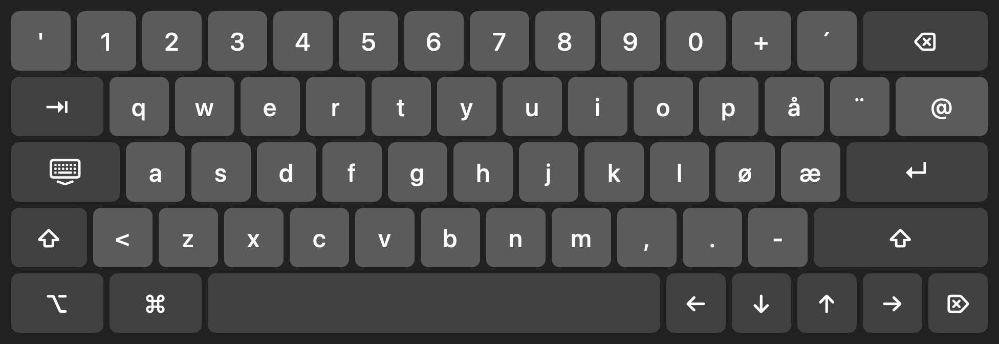

# FlipTouch

**Touch for the Samsung Flip on Apple silicon Macs.**

FlipTouch is a small menu bar app. It makes the touch screen of a Samsung Flip 55" work with a Mac that has an Apple
silicon chip (M1 or later), with taps, drags, scrolling, pinch-to-zoom, gestures and a large on-screen keyboard.

The Flip's touch glass needs a driver on a Mac, and the one that was used for it (UPDD) runs only on Intel Macs.
FlipTouch replaces it. It reads the touch screen directly over USB and turns touches into normal macOS pointer, scroll
and keyboard events. No kernel or driver extension is installed.

**[Download FlipTouch 1.0](https://github.com/PatoLocos/Flip/releases/latest)** (Apple silicon, macOS 13 Ventura or
later). The app is signed and notarized by Apple, so it opens like any other downloaded app.

## What you need

- A Mac with Apple silicon: M1, M2, M3, M4 or later. Intel Macs are not supported.
- macOS 13 Ventura or later.
- A Samsung Flip 55" (WM55R), connected to the Mac with HDMI for the picture and the USB touch cable for touch.

Other screens with the same FlatFrog touch glass (USB id `25b5:0054`) are likely to work too, but only the Flip 55" has
been tested.

## Install

1. Download `FlipTouch-1.0-arm64.zip` from [Releases](https://github.com/PatoLocos/Flip/releases/latest) and open it.
2. Move **FlipTouch** to your **Applications** folder and open it. A hand icon appears in the menu bar.
3. macOS asks for the **Accessibility** permission. Allow it in **System Settings → Privacy & Security →
   Accessibility**. FlipTouch needs it to move the pointer and to type.
4. In the hand icon's menu, turn on **Open at Login**.

## Gestures

| Touch | Does |
| --- | --- |
| Tap | Click |
| Double tap | Double-click |
| Drag one finger | Click and drag |
| Hold one finger still (0.6 s) | Right-click (can be switched to press-and-hold in the menu) |
| Two fingers, move | Scroll, with momentum |
| Two fingers, pinch | Zoom (⌘+ / ⌘−) |
| Two-finger tap | Right-click |
| Three fingers, swipe left / right | Switch Space |
| Three fingers, swipe up / down | Mission Control / App Exposé |
| Four fingers, hold still 1 s | Rotate the Mac's screen between landscape and portrait |
| Pen | Same as one finger |

## On-screen keyboard



Tap into a text field and a large keyboard slides in at the bottom of the screen. If it would cover the field, it
appears at the top instead. Tap anywhere that isn't a text field, or the hide key left of A, and it goes away.

- It follows the keyboard layout selected in macOS. The picture shows Norwegian, with æ ø å and the dead keys ´ and ¨.
  It types real key presses, so shortcuts and accents work as on a hardware keyboard.
- ⇧, ⌥ and ⌘ apply to the next key. Tap ⇧ twice for caps lock.
- ⌫, ⌦ and the arrow keys repeat while held. Letters type when the finger lifts, so you can slide to correct.
- Fingers that start on the keyboard only type, so fast two-finger typing is never taken for a scroll or right-click.
- **Show Keyboard** in the menu opens it by hand. **Show Keyboard for Text Fields** turns the automatic keyboard on or off.

## Portrait

When the Flip is turned to portrait, it shows the Mac's picture upright and smaller, between black bands. Touch works
there without changing anything.

For a full-screen portrait desktop:

1. Rotate the Mac's screen: hold **four fingers** still on the screen for a second, or choose **Rotate Mac Screen to
   Portrait** in the menu.
2. On the Flip, **short-press its power button**, then press **rotate** in the control bar that appears.

To go back to landscape, do the same again. Touch follows the Mac's rotation by itself. The Flip doesn't tell the Mac
when it is turned, so step 2 is always done on the Flip.

## Menu

- **Touch Enabled** turns touch on or off.
- **Show Touch Points** draws a circle under each finger, to check that touches land in the right place.
- **Display** picks the screen touches go to. **Automatic** picks the Samsung screen.
- **Rotation** follows System Settings → Displays. Override it here if touches land in the wrong place in portrait.
- **Mirror Horizontally / Vertically** fixes touches that land on the opposite side.

## If something doesn't work

**Touch doesn't move the pointer after an update.** macOS may still hold the permission for the old copy. Run this in
Terminal, start FlipTouch again and allow it when macOS asks:

```bash
tccutil reset PostEvent no.norwayanalytics.FlipTouch && tccutil reset Accessibility no.norwayanalytics.FlipTouch
```

**macOS asks for Input Monitoring.** On Macs where UPDD was installed before, a small file it left behind
(`/Library/Extensions/tbupddmxhid.kext`) keeps macOS's own driver away from the touch glass, and FlipTouch reads the
screen directly over USB. Keep that file: it contains no code. Without it, FlipTouch reads the screen through macOS's
own touch driver, and macOS asks for the Input Monitoring permission. That way of reading the screen has not yet been
tested on the Flip.

**Checking what the screen sends.** Quit FlipTouch, then run:

```bash
/Applications/FlipTouch.app/Contents/MacOS/FlipTouch --dump
```

It prints every touch the screen reports, without moving the pointer.

## Privacy

FlipTouch works only on your Mac. It reads the touch screen and sends pointer and key events to macOS. It collects
nothing and sends nothing anywhere.

## About

FlipTouch 1.0, for Apple silicon. This repository holds the app and its documentation; the source code is not
published.

FlipTouch is free to download and use. It is provided as is, without warranty of any kind.

Samsung and Flip are trademarks of Samsung Electronics; FlatFrog is a trademark of FlatFrog Laboratories. FlipTouch is
not affiliated with or endorsed by either.
